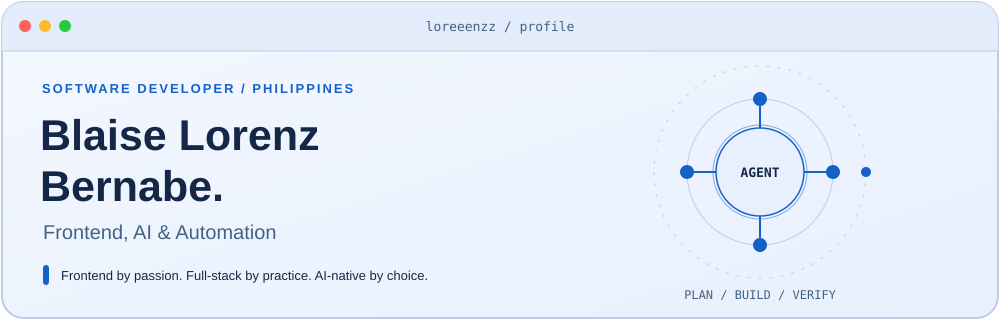
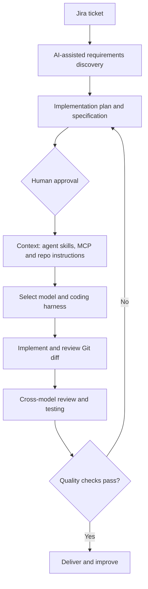

<picture>
  <source media="(prefers-color-scheme: dark)" srcset="./assets/header-dark.svg">
  <source media="(prefers-color-scheme: light)" srcset="./assets/header-light.svg">
  
</picture>

PHILIPPINES &nbsp; / &nbsp; OPEN TO COLLABORATION, FREELANCE &amp; JOB OPPORTUNITIES

<!-- Replace the four sample.com contact links with your public profile URLs before sharing. -->

## 01 / About me

I'm **Blaise Lorenz Bernabe**, a frontend-focused software developer based in the Philippines. I build intuitive interfaces, full-stack applications, and automations that turn repetitive work into reliable workflows.

Frontend is where my creativity lives; full-stack development is where I bring ideas to life. My approach to AI is deliberate: I plan first, engineer context, orchestrate coding agents, and verify the code I ship.

- Currently the main developer of **Prospect Analyzer at N-Compass**, a US-based company.
- Focused on frontend performance, code quality, and maintainable systems.
- Interested in local LLMs, personal AI assistants, creative web development, and self-hosting.
- Working toward a senior software engineering role and eventually building my own AI products.

## 02 / Current work & professional experience

| Role | Focus |
| :--- | :--- |
| **Main Developer — Prospect Analyzer, N-Compass** | Full-stack development, UI implementation, backend integration, and workflow improvement. |
| **Freelance & personal projects** | Web and mobile development, AI-assisted applications, automation, and experimentation. |

I enjoy translating requirements into usable features, improving existing code, and finding opportunities to automate manual processes. My goal is to make software easier to use, easier to maintain, and easier to evolve.

## 03 / Selected technologies

A curated view of the tools I work with regularly, alongside my core AI engineering toolkit. This is not an exhaustive inventory.

**Frontend & interface engineering**

<picture>
  <source media="(prefers-color-scheme: dark)" srcset="https://skillicons.dev/icons?i=ts,js,react,nextjs,vue,angular,vite,tailwind,figma&amp;theme=dark">
  <source media="(prefers-color-scheme: light)" srcset="https://skillicons.dev/icons?i=ts,js,react,nextjs,vue,angular,vite,tailwind,figma&amp;theme=light">
  
</picture>

   

**Backend & data**

<picture>
  <source media="(prefers-color-scheme: dark)" srcset="https://skillicons.dev/icons?i=nodejs,py,fastapi,dotnet,postgres,supabase,mysql,mongodb,firebase&amp;theme=dark">
  <source media="(prefers-color-scheme: light)" srcset="https://skillicons.dev/icons?i=nodejs,py,fastapi,dotnet,postgres,supabase,mysql,mongodb,firebase&amp;theme=light">
  
</picture>

   

**AI engineering — core toolkit**

     

     

**Automation, infrastructure & quality**

<picture>
  <source media="(prefers-color-scheme: dark)" srcset="https://skillicons.dev/icons?i=git,github,githubactions,docker,linux,cloudflare,vercel,aws,vscode&amp;theme=dark">
  <source media="(prefers-color-scheme: light)" srcset="https://skillicons.dev/icons?i=git,github,githubactions,docker,linux,cloudflare,vercel,aws,vscode&amp;theme=light">
  
</picture>

       

More technologies I've worked with

React Native, Expo, Flutter, SwiftUI, Kotlin, Dart, Java, C#, C, C++, Go, PHP, SQL, Bash, PowerShell, Astro, Three.js, OpenCV, YOLO, Graphify, Firebase, Stripe, PayPal, Google Maps API, Mapbox, Leaflet, Docker Compose, Google Cloud, Render, Netlify, Ollama, OpenRouter, Vercel AI SDK, OpenAI Agents SDK, Claude Agent SDK.

## 04 / How I engineer with AI

> Frontend by passion. Full-stack by practice. AI-native by choice.

AI assists much of my development, but the decisions, standards, and accountability remain mine. I use T3 Code to manage multiple coding harnesses and choose agents based on task complexity, context needs, and usage constraints.

| Practice | What it means in my workflow |
| :--- | :--- |
| **Spec-driven development** | Clarify requirements and approve a plan before implementation. |
| **Context engineering** | Reusable skills, `AGENTS.md`, `CLAUDE.md`, MCP, and relevant repository context. |
| **Agent orchestration** | Separate planning and implementation; match the model to the task. |
| **Resource efficiency** | Reduce irrelevant context, compact sessions, monitor usage, and choose cost-effective models. |
| **Verification** | Review generated code and diffs, run tests, validate migrations, and check architecture and security. |

I believe good AI output starts with good context. Engineering fundamentals, human judgment, and maintainability still matter.

## 05 / Featured work

| Project / area | What I work on |
| :--- | :--- |
| **Prospect Analyzer** | Professional full-stack application at N-Compass; my main development project. |
| **AI & automation workflows** | Agent-assisted development, scheduled workflows, browser automation, web scraping, and API integrations. |
| **Web & mobile development** | Landing pages, dashboards, REST APIs, cross-platform applications, and computer vision projects. |

<!-- Add individual public repository links here when you have chosen which projects to showcase. No confidential company URLs are included. -->

[Explore my public repositories](https://github.com/Loreeenzz?tab=repositories)

## 06 / GitHub activity

<picture>
  <source media="(prefers-color-scheme: dark)" srcset="./assets/generated/languages-dark.svg">
  <source media="(prefers-color-scheme: light)" srcset="./assets/generated/languages-light.svg">
  
</picture>

<picture>
  <source media="(prefers-color-scheme: dark)" srcset="https://github-profile-trophy.vercel.app/?username=Loreeenzz&amp;theme=darkhub&amp;column=4&amp;margin-w=10&amp;margin-h=10">
  <source media="(prefers-color-scheme: light)" srcset="https://github-profile-trophy.vercel.app/?username=Loreeenzz&amp;theme=flat&amp;column=4&amp;margin-w=10&amp;margin-h=10">
  
</picture>

<picture>
  <source media="(prefers-color-scheme: dark)" srcset="https://github-readme-activity-graph.ashutosh-dwivedi0710.workers.dev/graph?username=Loreeenzz&amp;bg_color=0b1528&amp;color=a9bfdc&amp;line=60a5fa&amp;point=93c5fd&amp;area=true&amp;area_color=2563eb&amp;hide_border=true">
  <source media="(prefers-color-scheme: light)" srcset="https://github-readme-activity-graph.ashutosh-dwivedi0710.workers.dev/graph?username=Loreeenzz&amp;bg_color=f3f7ff&amp;color=142746&amp;line=2563eb&amp;point=1462c9&amp;area=true&amp;area_color=93c5fd&amp;hide_border=true">
  
</picture>

<picture>
  <source media="(prefers-color-scheme: dark)" srcset="./profile-3d-contrib/profile-night-view.svg">
  <source media="(prefers-color-scheme: light)" srcset="./profile-3d-contrib/profile-green-animate.svg">
  
</picture>

<picture>
  <source media="(prefers-color-scheme: dark)" srcset="./assets/generated/snake-dark.svg">
  <source media="(prefers-color-scheme: light)" srcset="./assets/generated/snake-light.svg">
  
</picture>

Language statistics reflect visible repository code, not proficiency. Trophies and the view counter are community-generated metrics, not official GitHub awards or unique visitor counts.

## 07 / Beyond the code

When I'm not building software, I'm customizing my Mac, gaming, experimenting with new AI tools, or exploring ways to make my setup simpler and more productive. I like minimalism, thoughtful design, and learning by building.

## 08 / Let's connect

I'm open to **software development opportunities, freelance work, and collaborations** with developers, startups, and international teams. If you're building something that combines great user experiences with intelligent automation, I'd love to hear about it.

[Email](mailto:blaiselorenztbernabe@gmail.com) · [GitHub](https://github.com/Loreeenzz) · [LinkedIn](https://sample.com) · [Portfolio](https://sample.com) · [Facebook](https://sample.com) · [Instagram](https://sample.com)

---

BUILD INTENTIONALLY. AUTOMATE INTELLIGENTLY.

